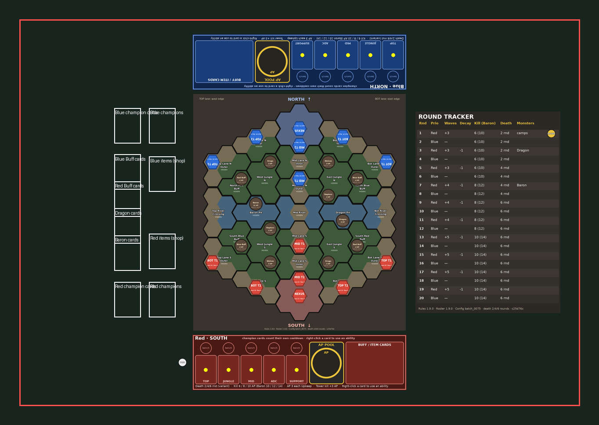

# Hex-Nexus: Tabletop Simulator mod

A Tabletop Simulator (TTS) table for playtesting Hex-Nexus with people. Every
number, hex, champion and item on the table is **generated from this
repository**. After a rules, roster or config change, run one command to
rebuild the mod.

| Milestone | State |
|---|---|
| **M0 static mod** | **Done**, checked in real TTS. Board, tiles, all components and cards are generated from the repo. |
| **M1 bookkeeping** | **Built**, verified headless; awaiting a real-TTS check. Start game; automated Upkeep and World Phase; AP, kills, tower falls, monster rewards and the round-20 tiebreak. |
| M2 action assist | partly: abilities pay AP and set the cooldown from the card menu, chips bank AP, protection-order warnings. Still to come: legal move and target highlighting, ability resolution by icon. The **parity harness is built** (`tts/tests/run.lua`) and covers what M1 automates. |
| M3 telemetry | later |
| M4 bridge (stretch) | later |

Current build: **Rules 1.9.0 · Roster 1.9.0 · Config `batch_0075`**. That is
the settled v1.9 rules with **2 / 4 / 6 death timers**, a playtest variant
(the rulebook stays at 3 / 4 / 5). South has priority in round 1. A kill by a
team holding the Baron pays two Empowered waves (the designer's rule; the
engine is being fixed to match). Rulebook-vs-engine differences are listed in
[`RULES_DISCREPANCIES.md`](RULES_DISCREPANCIES.md). The one-page quick start
for testers is [`PLAYTEST_GUIDE.md`](PLAYTEST_GUIDE.md).



## Build

```bash
pip install pillow
python tools/tts_export.py --rules 1.9.0 --roster 1.9.0 --config reports/requests/batch_0075.json
python tools/tts_preview.py          # optional: tts/build/preview.png, a top-down check
```

The build writes to `tts/build/`:

| File | What |
|---|---|
| `HexNexus_<rules>_<roster>.json` | The TTS save: every object, the Global script and each object's script inlined, plus the panel UI. |
| `data.lua` | Every number the mod uses, as Lua tables: map, roster, items, config, per-round schedule and layout. It is inlined at the top of the Global script. |
| `assets/` | 143 PNGs: 27 hexgroup tiles × 2 sides, the mat, 2 dashboards, the round tracker, the card sheets, standees, structures, monsters, wave tokens, AP counters and markers. Every URL carries a fingerprint of the file's contents (`?v=…`), so a rebuild can never show a stale image from TTS's cache. |

Options:

- `--config`: any sim request with `config_overrides`. For example,
  `batch_0074.json` builds the 3 / 4 / 5 death timers. The config is
  `engine/config.py` `DEFAULT_CONFIG` with the overrides applied, exactly as
  the simulator does it.
- `--asset-base URL`: where TTS fetches the images from (see *Hosting*).

The build stamps the rules, roster and config versions and the git commit on
the mat, the tracker, the item cards and the panel. A commit ending in
`-dirty` means the build was made with uncommitted source changes.

### What reads what

| Source | Used for |
|---|---|
| `rules/Hex-Nexus_Rules_v<rules>.md` | version label (the file must exist) |
| `rules/map_v1.json` | tiles, terrain, structures, lane paths, spawn hexes, monster hexes |
| `roster/roster_v<roster>.json` via `engine.kits.load_roster` | champion cards, standees, HP counters (L0 added as the engine does) |
| `engine/config.py` + request overrides via `engine.config.make_config` | structure HP and floors, decay schedule, wave sizes, kill AP, death positions, monster HP and spawns, AP base, Dragon and Baron card text |
| `engine/items.py` | item and buff cards |
| `engine/resolve.py` `DEATH_BANDS` | the round bands of the death track |

## Load in TTS

1. Copy `tts/build/HexNexus_1.9.0_1.9.0.json` into your TTS saves folder:
   - Windows: `Documents\My Games\Tabletop Simulator\Saves\`
   - macOS: `~/Library/Tabletop Simulator/Saves/`
   - Linux: `~/.local/share/Tabletop Simulator/Saves/`
2. In TTS: **Create → Singleplayer / Multiplayer → Games → Save & Load**, and
   pick *Hex-Nexus 1.9.0 / 1.9.0 (batch_0075)*.
3. **First load:** once the images have downloaded, the Global script lays out
   the table. It sizes every generated object to its drawn size and puts it on
   its hex. The chat shows *"Hex-Nexus: laid out N objects."*
   - If the board art looks **rotated 180°** (NORTH printed at the bottom from
     the South seat, or coordinates upside down), press **Art 180°** on the
     panel. TTS's default image orientation could not be checked from here, so
     this switch is built in.
   - **Re-layout** (host or promoted players only) puts every generated object
     back in its starting place.
4. Save the game in TTS once it looks right. The layout is stored and does not
   run again.

## Hosting the images

TTS loads images from URLs.

- **Default: raw GitHub.** The build points at
  `https://raw.githubusercontent.com/Noitues/Games/<branch>/tts/build/assets/`.
  The repo is public, so this works as soon as the build is pushed.
  - If the branch is deleted or renamed, the URLs break. Rebuild with
    `--asset-base` pointing at the new branch or a commit SHA.
  - TTS caches images by URL. Each URL ends in a fingerprint of the image's
    contents, so a changed image always gets a new URL and is downloaded
    again. You no longer need to clear the cache after a rebuild.
- **Steam Cloud, for a stable public mod:** load the save with any working URLs.
  Open **Modding → Cloud Manager → Upload all loaded files**, then save. TTS
  rewrites every URL in the save to your Steam Cloud copy.
- **Local, while iterating:**
  `--asset-base file:///C:/path/to/Games/tts/build/assets`. Only works on your
  own machine.

## Play

See [`PLAYTEST_GUIDE.md`](PLAYTEST_GUIDE.md) for the tester's version.

- **Start game:**
  - deals one champion per role to each team, with no champion on both sides
    (the simulations' rule);
  - a card you put in a role slot first is kept, so you can draft by hand or
    let it fill the rest at random;
  - puts the standees in their base and runs round 1's Upkeep, with South
    holding priority.
- **Next phase ▶** walks the round:
  - **Upkeep** runs automatically:
    - monsters that were hit but survived heal to full (designer's ruling);
    - cooldowns count down, and dead champions respawn at the fountain;
    - champions at their fountain heal;
    - structures decay;
    - AP resets;
    - waves move and spawn;
    - monsters respawn;
    - hexgroups flip back.
  - **Action:** players act. **Next activation ▶** steps the snake order, and
    the panel shows whose activation it is.
  - **World** runs automatically: waves, towers and monsters hit, and kills,
    falls and rewards are applied.
  - **Shop**, then **Win Check**: a Nexus at 0 ends the game, and round 20
    goes to the tiebreak.
- **Champion cards** sit in the five role slots on each dashboard and count
  their own cooldown: READY, CD n or DEAD n.
  - Right-click → *Use Q · 1 AP · CD1* pays the AP and puts the whole card out
    for that many rounds (Rules 5.2). It is refused if the card is on cooldown
    or the pool cannot pay.
  - Clicking the label adjusts the cooldown by hand.
- **HP counters** on champions, towers, the Nexus, monsters and waves:
  left-click −1, right-click +1.
  - A chip off a monster or an enemy wave is **+1 AP** for the clicker's team
    (Blue or Red seat). From any other seat it goes to whoever's activation it
    is.
  - A champion at 0 is a kill. Its card goes to the death position, the killer
    gains the kill reward (Baron included), and the standee goes to its bench.
  - A monster at 0 is taken: its card is dealt to the taker's hand (Blue Buff,
    Red Buff, Dragon up to the cap, Baron) and its respawn round is set.
  - A tower at 0 falls and pays the tower reward; a Nexus at 0 ends the game.
  - Hitting a protected structure gives a warning.
- **AP counter:** one big number per team; click to adjust.
- **Buff and item cards:** right-click → *Play* or *Buy*.
  - Blue Buff adds its AP.
  - Dragon goes on its own cooldown.
  - Red Buff and Dragon hits are applied by clicking the target's HP.
- **Hexgroups:** right-click → *Flip hexgroup*, or the **Hex-Nexus: flip
  hexgroup** hotkey, which flips the tile under the cursor.
- **Map view:** the panel button, or the **Hex-Nexus: map view** hotkey, gives
  a top-down camera on the board.
- Bind the hotkeys in **Options → Game Keys**.

**Not automated yet (M2):**
- movement;
- ability targeting and effects (shields, slows, roots, pushes);
- item effects on champions (Ionian Charm's shorter cooldowns, Boots, Long
  Sword, …);
- legal-move highlighting.

These are played by hand. Shields are not tracked on the table, so World
Phase hits ignore them.

## Collecting logs

Arrives with M3: an event log, JSONL game records sent to
`tools/tts_collect.py`, and a feedback card.

## Testing

```bash
apt-get install lua5.2                       # once
lua5.2 tts/tests/run.lua                     # parity: Lua rules core vs the Python engine
python tts/tests/smoke.py                    # the table, headless (rebuilds first)
python tools/tts_parity.py                   # regenerate the parity scenarios (~6 min)
```

**Parity harness** (`tts/tests/run.lua`, scenarios from `tools/tts_parity.py`):
- The scenarios come from 8 real engine games (T1_greedy and T2_sieger AIs,
  3 ending in a Nexus kill). Every Upkeep and every World Phase is a scenario:
  the state before it, and the state the **engine** produced.
- 16 synthetic World Phases add a minion wave taking each T1 and each Nexus,
  plain and Empowered. AI games rarely produce those, because champions take
  most towers.
- `tts/lua/core.lua` runs the same step, and every field it models is
  compared: round and priority, hidden tiles, champion HP, life, cooldown and
  hex, waves, structures, monsters, AP, kills, towers lost, Baron and Dragon
  cards.
- Currently **316 scenarios, 316 match** (152 Upkeeps, 164 World Phases).
- The scenarios cover:
  - 19 kills and 21 respawns;
  - 116 tile flips;
  - Empowered waves;
  - tower falls and Nexus wins by waves;
  - world-phase AP rewards.
- A mutation check confirms the harness can fail: breaking fountain healing,
  tower damage or the reveal rule makes 11 to 156 scenarios differ.
- The two designer rulings the engine does not have yet (the Baron kill
  bonus, monster healing) are switched off for parity and checked by the
  smoke test instead.

**Smoke test** (`tts/tests/smoke.py`, against the fake TTS API in
`tts/tests/tts_stub.lua`):
- layout and stacking;
- per-round numbers against the engine;
- hotkeys and the map camera;
- Start game, including a hand-drafted card;
- ability use, AP for chips, a monster reward card and playing it, a kill,
  buying an item.
- It then plays the whole game out to the round-limit tiebreak through **Next
  phase**. After **every** automated phase it checks that what the table
  shows equals the core run on what the table showed before. This catches
  anything lost or garbled between the table and the core.
- Currently **949 checks, 0 failed**.

### Checked in real TTS (first load, 2026-09-28)

- **Image orientation is right:** North is at the top from the South seat.
  **Art 180°** is not needed.
- The panel, round tracker, round marker, structures and monsters load and
  sit where they should.
- **Fixed after that load:**
  - the hexgroup tiles were locked under the mat's surface; they now stack on
    its measured top;
  - the layout ran off `Table_RPG` (about 58 × 40 units); it is now compacted
    (hex 1.0, one-row dashboards, cards at 0.75 scale);
  - the HP labels covered the token art.

Second load (2026-10-13): tiles show and flip correctly. The misaligned
cooldown slots were TTS showing **cached old images**. That is why URLs now
carry a content fingerprint.

### Still to confirm in TTS (M1 build)

- Start game takes the right cards and standees out of their deck and bag.
- Card labels and the AP counter's big number sit where they should.
- The map-view camera angle, which is set blind.
- Waves are spawned and moved by Upkeep onto their lane hexes.

## Files

```
tools/tts_export.py     the exporter (sources → data.lua, images, save)
tools/tts_art.py        Pillow renderers (no game numbers of its own)
tools/tts_preview.py    top-down PNG of the table from the save + images
tools/tts_parity.py     exports engine scenarios for the parity harness
tts/lua/core.lua        the rules core: Upkeep, World, visibility, kills (pure Lua)
tts/lua/global.lua      Global script: layout, panel, the table <-> core adapter, Start game
tts/lua/counter.lua     HP counter: champions, structures, monsters, waves
tts/lua/card.lua        champion / buff / item cards: cooldown and right-click menus
tts/lua/ap.lua          the AP counter
tts/lua/tile.lua        hexgroup tile: "Flip hexgroup" context menu
tts/lua/ui.xml          the panel
tts/tests/run.lua       parity harness;  scenarios.json: its engine scenarios
tts/tests/smoke.py      headless table test;  tts_stub.lua: the fake TTS API
tts/build/              generated: save, data.lua, assets, preview
```
